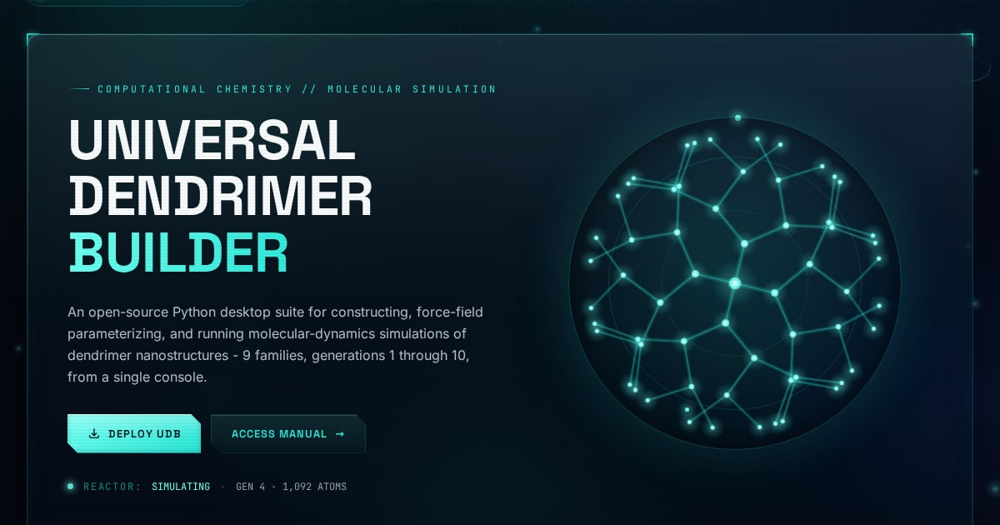

# Universal Dendrimer Builder — Website

**Live site:** https://universal-dendrimer-builder-showcas.vercel.app

The official website of the **Universal Dendrimer Builder (UDB)**, an open-source
Python desktop application for building, force-field parameterizing and simulating
dendrimer nanostructures (9 families, generations G1–G10, AMBER + NAMD pipeline).

The site hosts the documentation, installation guide, user manual, validation
benchmarks and an interactive 3D gallery of real UDB-built structures.



---

## What's on the site

| Page | What it shows |
|---|---|
| **Home** | Overview, live procedural dendrimer "reactor", feature modules, structure previews, size estimator |
| **UDB Overview** | Features, force-field support matrix, the seven-stage placement engine |
| **Installation** | Linux setup: Conda, AmberTools25, NAMD 3.x, known issues |
| **User Manual** | Tab-by-tab workflow, theory and key parameters |
| **Structure Gallery** | Live, rotatable 3D models of every family (core, monomer and G1–G6), with characterization and build-log data |
| **Benchmarks** | Atom counts, Rg and asphericity validated against literature (Maiti et al. 2004) |
| **Size Estimator** | Interactive terminal-group, atom-count, mass and Rg estimates |
| **Changelog / About** | UDB version history, author and citation |

## Design and performance

- **Fusion HUD / liquid-glass** interface: frosted glass panels, animated scientific
  background, Space Grotesk + Inter + JetBrains Mono typography.
- **Adaptive performance tiers.** On load, every device is rated `high`, `mid` or `low`
  from its hardware. A frame-rate governor then steps the site down if it runs slowly
  (`src/components/PerfTier.astro`). Lower tiers keep the same look but drop live blur,
  cap animation frame rates and load 3D models on tap. Low-end phones stay smooth.
- **3D structures** are rendered with [3Dmol.js](https://3dmol.org) (pinned 2.5.5,
  self-hosted in `public/vendor/3dmol/`). It loads only when a model scrolls near view.
- Respects `prefers-reduced-motion` and `prefers-reduced-transparency`, and works without JavaScript.
- Testing override: append `?perf=high`, `?perf=mid` or `?perf=low` to any URL (`?perf=auto` resets).

## Tech stack

[Astro 4](https://astro.build) (static site) · [Tailwind CSS 3](https://tailwindcss.com) ·
React 18 (size-estimator island only) · 3Dmol.js · deployed on [Vercel](https://vercel.com).

## Run locally

Requires Node.js 18+.

```bash
npm install
npm run dev        # http://localhost:4321
npm run build      # production build → dist/
npm run preview    # serve the production build
```

## Project structure

```
├── public/
│   ├── images/            figures, renders, social preview image
│   ├── mol2/              structure files shown in the 3D gallery
│   └── vendor/3dmol/      pinned 3Dmol.js build + license
├── scripts/               Python tools that regenerate the structure dataset
│   ├── build_structures.py      UDB output → public/mol2 + structures.generated.json
│   ├── enrich_from_logs.py      adds build/MD-setup data from UDB build logs
│   └── make_validation_chart.py regenerates the benchmark figure
├── src/
│   ├── components/        Nav, Footer, viewers, canvases, PerfTier, LiquidGlass …
│   ├── data/              dendrimer metadata + generated structure dataset
│   ├── layouts/           page shell (SEO, fonts, global effects)
│   ├── pages/             one file per route
│   └── styles/global.css  theme, liquid-glass layer, performance tiers
├── astro.config.mjs
└── vercel.json            build settings + cache headers
```

### Updating the structure gallery

The raw UDB build outputs (`Structures/`, about 45 MB of AMBER/NAMD files) are kept
locally and are not committed. After producing new structures:

```bash
python3 scripts/build_structures.py
python3 scripts/enrich_from_logs.py
npm run build
```

## Branches and releases

| Branch | Purpose |
|---|---|
| `main` | Stable. Always matches the live site, and every push deploys to production. |
| `dev` | Day-to-day work. Every push gets its own Vercel preview URL. Merge into `main` when ready. |

Releases are tagged with [semantic versions](https://semver.org) (`v1.0.0`, `v1.1.0`, …)
and recorded in [CHANGELOG.md](CHANGELOG.md).

## Citation

UDB paper in preparation. Until it is published, please cite the software
(BibTeX on the [UDB page](https://universal-dendrimer-builder-showcas.vercel.app/tools/udb/#citation)).

## License

The website code and content are released under the [MIT License](LICENSE).
3Dmol.js is © University of Pittsburgh and contributors, BSD-3-Clause
(`public/vendor/3dmol/LICENSE.txt`). The UDB software is MIT-licensed in its own repository.

## Author

**Hirusha Walgampaya**, Department of Chemistry, University of Peradeniya, Sri Lanka
· [hiruwalgampaya@gmail.com](mailto:hiruwalgampaya@gmail.com)

The UDB software lives at [HirushaW/universal-dendrimer-builder](https://github.com/HirushaW/universal-dendrimer-builder).
